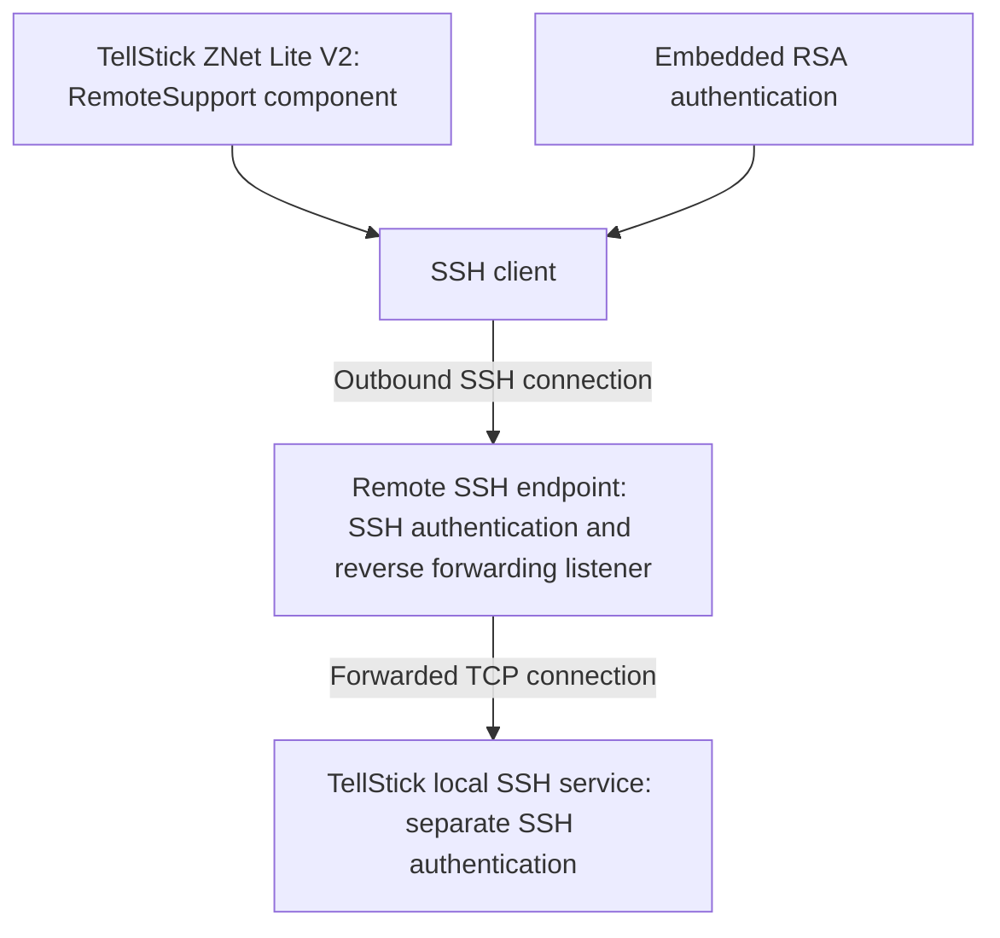

# Remote Support Architecture and Embedded SSH Key

[Documentation index](../README.md#documentation)

## Overview

Firmware 1.3.2 includes a Python remote-support component and an RSA private
key in its filesystem. Its code implements outbound SSH reverse forwarding.
An earlier narrative reports reproduction against a researcher-controlled
endpoint, but a sufficient primary transcript was not located. That runtime
claim remains unresolved; no local SSH authentication bypass is established.

## Research Environment

| Property | Observed value |
| --- | --- |
| Device | Telldus TellStick ZNet Lite V2 |
| Examined firmware | 1.3.2 |
| Operating system | OpenWrt Designated Driver r49388 |
| Linux kernel | 4.1.23 |
| Application runtime | Python 2.7 |
| Remote-support package | Telldus-Remotesupport 0.1 |
| Authentication material | RSA private key in PEM format |
| Transport | SSH |
| Remote access mechanism | Reverse TCP port forwarding |
| Reported controlled-test endpoint | Researcher-controlled SSH server; primary transcript not located |

The investigation was performed on personally owned hardware and a locally extracted firmware filesystem.

## Discovery of the Remote-Support Package

Filesystem inspection identified a Python package named Telldus-Remotesupport.

The installed package metadata is located at:

```text
/usr/lib/python2.7/site-packages/
    Telldus_Remotesupport-0.1-py2.7.egg-info/
```

The package inventory also references the following files:

```text
/usr/lib/python2.7/site-packages/remotesupport/
    __init__.pyc
    RemoteSupport.pyc
    id_rsa
```

The main application startup configuration includes a remote-support component:

```text
'remotesupport': ['RemoteSupport']
```

This establishes that remote support is integrated into the gateway’s Python application architecture rather than being an unrelated external utility.

### Package entry point

The extracted package metadata contains:

```text
c = remotesupport:RemoteSupport [creq]
```

The component therefore participates in the application’s Python package and initialization system.

## Embedded RSA Private Key

The firmware filesystem contains a private-key file at:

```text
/usr/lib/python2.7/site-packages/remotesupport/id_rsa
```

This location is part of the installed application package rather than a conventional per-user SSH directory.

### Original filesystem evidence

The following file listing is reproduced from the examined filesystem:

```text
usr/lib/python2.7/site-packages/remotesupport/RemoteSupport.pyc
usr/lib/python2.7/site-packages/remotesupport/id_rsa
usr/lib/python2.7/site-packages/remotesupport/__init__.pyc
```

The file identification command returned:

```text
usr/lib/python2.7/site-packages/remotesupport/id_rsa: PEM RSA private key
```

The file was identified as an RSA private-key container. Neither its contents
nor a copy of the key is included in this repository.

### Significance

An SSH private key included in a firmware filesystem is recoverable by a party who obtains sufficient access to that filesystem.

This differs from a private key generated uniquely on a device during initial setup and stored only on that device.

However, identifying an embedded key in one examined firmware image does not, by itself, establish whether the same key is present in every manufactured unit or firmware release.

The deployment scope of the key remains an important unanswered question.

## Remote-Support Connection Architecture

The investigated mechanism uses an outbound SSH connection initiated by the gateway.

Instead of requiring an inbound connection directly to the gateway from the internet, the device connects to a remote SSH endpoint.

The SSH connection can then carry a reverse port forward back toward a local service on the gateway.

### Logical connection flow



The diagram represents the source-derived mechanism, not a complete specification of the manufacturer’s production support infrastructure.

## How Reverse SSH Forwarding Works

Ordinary SSH typically allows a client to establish an encrypted connection to a remote SSH server.

SSH also supports TCP forwarding.

With reverse forwarding, the client requests that the remote SSH server make a listening endpoint available and forward accepted connections back through the existing encrypted session.

In the examined architecture, the TellStick acts as the SSH client.

The sequence is:

1. The remote-support component starts on the gateway.
2. An SSH client establishes an outbound connection.
3. The embedded private key is used as authentication material for that connection.
4. The client requests reverse TCP forwarding.
5. The remote SSH endpoint accepts forwarded connections according to its configuration and authorization rules.
6. Traffic is carried through the established SSH session to the gateway’s local SSH service.
7. The local SSH service applies its own authentication requirements.

The precise availability and reachability of the remote listener depend on the SSH server configuration.

For example, a reverse-forwarded listener may be restricted to the remote host’s loopback interface rather than exposed to other network clients.

A reverse tunnel creates a network path. It does not automatically grant an authenticated shell session on the destination device.

## Authentication Boundaries

There are two separate SSH authentication contexts.

### A. Gateway to remote-support server

The gateway establishes the outbound SSH connection.

The embedded RSA private key is associated with authentication of this connection.

Successful authentication depends on the remote server accepting the corresponding public key and any applicable account or forwarding restrictions.

### B. Remote endpoint to gateway SSH service

Once a reverse forward is established, a connection can be carried to the gateway’s local SSH service.

That service has its own authentication configuration.

The private key used to establish the outbound support tunnel does not automatically authenticate a client to the gateway’s local SSH server.

These authentication boundaries are important when assessing the security impact of the embedded key.

## Controlled verification: evidence gap

An earlier account describes a researcher-controlled reverse-forwarding
experiment. Its primary connection/forwarding transcript was not located,
while the static security review explicitly leaves a live support tunnel
unverified. The narrative alone is insufficient to classify reproduction as
runtime verified. It is retained as an unresolved historical report, not
proof that the installed RemoteSupport package completed a tunnel.

Filesystem and code evidence establish the package, embedded private-key
file, startup registration, outbound SSH role, and forwarding target. Owner
root SSH was verified independently; the November 3 record identifies fresh
public-key authentication, without use of the vendor support key. Later
modified-runtime checks found support imports blocked, no registered support
handler, and no vendor private key; they did not establish a tunnel.

No access to manufacturer support infrastructure, other customers' gateways,
local authentication bypass, universal key reuse, or arbitrary-device support
activation is established. No operational endpoint or authentication material
is published.

## Security Considerations

### Recoverable authentication material

The private key is stored in an application package within the firmware filesystem.

Anyone with sufficient access to the firmware contents may be able to recover the same material.

The security impact depends on what that key is authorized to do.

### Potential credential reuse

If identical private-key material is distributed across multiple devices, compromise of one firmware image could expose authentication material shared by other installations.

This is a conditional risk.

The investigation has not conclusively established the extent of key reuse across devices or firmware releases.

### Server-side restrictions

An SSH server can restrict what an authenticated key is allowed to do.

Relevant controls include:

- Restricting the account associated with the key.
- Limiting permitted forwarding destinations and listeners.
- Preventing interactive shell access.
- Restricting source addresses where practical.
- Monitoring support-session establishment.
- Revoking or rotating compromised credentials.

The effective risk cannot be determined from the presence of the private key alone.

### Reverse forwarding and network exposure

Reverse forwarding can provide access to a device located behind NAT or a firewall without opening an inbound port on the local router.

This is a legitimate remote-support technique.

However, it also creates an access path whose security depends on authentication, server policy, forwarding restrictions and operational controls.

### Local SSH authentication

The gateway’s SSH service remains a separate security boundary.

The source-derived forwarding mechanism should not be described as a root-login bypass.

## Recommended Security Design

For embedded remote-support implementations, the following design properties reduce the impact of credential exposure:

### Unique device credentials

Generate separate credentials for individual devices rather than embedding a shared private key in a common firmware image.

### Restricted server authorization

Grant remote-support identities only the permissions required to establish approved support sessions.

### Controlled forwarding

Restrict listening interfaces, ports and forwarding destinations.

### Credential revocation

Provide a practical mechanism to revoke and rotate authentication material.

### Explicit support-session lifecycle

Make support access time-limited, auditable and subject to appropriate authorization.

### Independent destination authentication

Preserve authentication at the final destination service even when a forwarding tunnel has already been established.

These are general security recommendations, not claims that the examined firmware implements or omits every listed control.

## Evidence Handling and Publication

The investigation distinguishes between technical observations and sensitive authentication material.

The following information may be documented:

- Installed package names
- Relevant filesystem paths
- File formats
- Component relationships
- Connection direction
- SSH forwarding architecture
- Results of controlled experiments
- Security boundaries and limitations

The following material is intentionally excluded:

- RSA private-key contents
- Authentication credentials
- Device-specific secrets
- Operational third-party support endpoint details
- Reusable authenticated connection configurations
- Unmodified firmware images containing sensitive material

Sanitized evidence should preserve the original technical meaning without exposing usable credentials.

## Findings Summary

| Finding | Evidence | Status |
| --- | --- | --- |
| Remote-support Python package exists | Installed package metadata | Confirmed |
| Application references remote support | Startup configuration | Confirmed |
| Embedded RSA private-key file exists | Filesystem listing and file identification | Confirmed |
| Private key is stored in firmware filesystem | Extracted filesystem inspection | Confirmed |
| Outbound SSH support mechanism | Implementation investigation | Investigated |
| Reverse TCP forwarding | Source path; earlier controlled-test narrative lacks a retained primary transcript | STATIC CODE VERIFIED; runtime reproduction unresolved |
| Separate local SSH authentication | Firmware authentication boundaries and independently recorded owner login | Owner SSH RUNTIME VERIFIED; support-forwarded login unresolved |
| Key reuse across all devices | Not established | Unknown |
| Access to production support infrastructure | Not tested | Not claimed |
| Authentication bypass | Not demonstrated | Not established |

## References

- [Telldus GitHub organization](https://github.com/telldus)
- [tellstick-server](https://github.com/telldus?tab=repositories&q=tellstick-server)
- [tellstick-server-plugins](https://github.com/telldus?tab=repositories&q=tellstick-server-plugins)
- [OpenSSH manual pages](https://www.openssh.com/manual.html)
